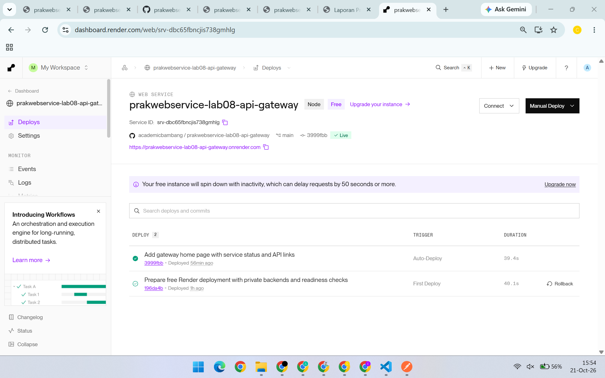

# Deployment demo ke Render

**Status: live dan terverifikasi pada 21 Oktober 2026.**

- URL gateway: **https://prakwebservice-lab08-api-gateway.onrender.com**
- [Katalog publik](https://prakwebservice-lab08-api-gateway.onrender.com/catalog/products) dan [kesiapan layanan](https://prakwebservice-lab08-api-gateway.onrender.com/readyz).
- [Dashboard Render](https://dashboard.render.com/web/srv-dbc65fbncjis738gmhlg).
- Deployment pertama: commit `196da4b`, 21 Oktober 2026 pukul 13:59 (UTC+7).
- Deployment terbaru pada screenshot manual: commit `3999fbb`, berstatus **Live**, termasuk halaman utama gateway.
- [Bukti status Live terbaru](evidence/render-dashboard.png), [log verifikasi publik deployment pertama](evidence/render-verification.txt), dan [hasil JSON](evidence/render-verification.json).

Konfigurasi yang dapat direproduksi tersedia pada [`render.yaml`](../render.yaml). Pengujian lokal terbaru lulus **40/40**, sesuai [log deployment](evidence/tests-deployment.txt).

Tabel berikut merangkum verifikasi otomatis pada deployment pertama. Log aslinya dipertahankan sebagai arsip; screenshot manual terbaru merupakan pengujian terpisah.

| Pemeriksaan publik | Hasil |
| --- | --- |
| `/readyz` dan `/catalog/products` | `200` |
| GraphQL katalog | `200`, field produk dan harga benar |
| Pesanan tanpa API key | `401` |
| Pesanan dengan API key | `200` |
| Pembuatan pesanan demo | `201`, total Rp170.000 |
| Detail melalui `Location` | `200`, ID dan total sesuai |
| Kuantitas nol / route tidak dikenal | `400` / `404` |
| 30 request katalog pada window bersih | 20 kali `200`, kemudian 10 kali `429` |
| Readiness setelah kuota API habis | Tetap `200` |



Screenshot Postman manual dari pengguna pada 21 Oktober 2026 menunjukkan katalog `200`, pesanan dengan key `200` (`data: []` saat tangkapan diambil), dan pesanan tanpa key `401`. Ketiganya memakai basis URL HTTPS Render yang sama pada port standar `443`. [Screenshot rate limit](evidence/rate-limit.png) berasal dari terminal VS Code saat menjalankan `npm run test:rate-limit` secara lokal, dengan 20 respons `200`, lalu 10 respons `429`, dan **LULUS**. Rincian asal gambar tersedia pada [daftar bukti manual](evidence/README.md).

## Susunan deployment

Satu **Render Free Web Service** menjalankan `npm start`, yang memulai tiga proses Node terpisah:

| Proses | Alamat di instance Render | Akses klien |
| --- | --- | --- |
| Gateway | `0.0.0.0:$PORT` | Publik melalui HTTPS Render |
| Catalog | `127.0.0.1:3000` | Melalui `/catalog/*` di gateway |
| Order | `127.0.0.1:3001` | Melalui `/orders/*` di gateway dan API key |

Ini adalah deployment demo dalam satu host. Ketiga proses tetap memiliki kode, port, dan tanggung jawab terpisah; deployment ini belum memberikan isolasi host atau scaling per service.

Pendekatan ini menjaga backend Order tidak terbuka langsung ke internet dan mencegah pemanggil melewati pemeriksaan API key. Ketika instance tidur atau aktif kembali, ketiga proses mengikuti siklus instance yang sama.

## Menyiapkan key deployment

Dari root repository:

```sh
npm run setup:render
```

Perintah membuat `gateway/.env.render` dengan key acak khusus deployment dan digest SHA-256-nya. File ini diabaikan oleh Git. Jangan mengunggahnya atau menyalin isinya ke laporan.

- **Render:** isi environment variable `API_KEY_SHA256` dengan digest dari file tersebut; biarkan `API_KEY` tidak disetel di Render.
- **Postman:** kirim key asli dari `API_KEY` pada header `X-API-Key`, bukan digest.

Key deployment terpisah dari key demo lokal dalam `gateway/.env`.

## Konfigurasi layanan

Gunakan Blueprint dari repository ini, atau buat satu Web Service dengan pengaturan berikut:

| Pengaturan | Nilai |
| --- | --- |
| Repository | `https://github.com/academicbambang/prakwebservice-lab08-api-gateway` |
| Branch | `main` |
| Runtime / versi | Node.js / `22` |
| Root directory | Kosong, gunakan root repository |
| Build command | `npm ci --omit=dev` |
| Start command | `npm start` |
| Instance | **Free** |
| Region | Singapore |
| Health check | `/readyz` |
| `NODE_ENV` | `production` |
| `HOST` | `0.0.0.0` |
| `TRUST_PROXY` | `1` |
| `CATALOG_SERVICE_URL` | `http://127.0.0.1:3000` |
| `ORDER_SERVICE_URL` | `http://127.0.0.1:3001` |
| `API_KEY_SHA256` | Digest privat dari `gateway/.env.render` |

Jangan hardcode `PORT`: Render mengisi port gateway. Supervisor tetap mengikat Catalog dan Order ke loopback, meskipun gateway memakai `HOST=0.0.0.0`.

`/readyz` memeriksa health kedua backend dan memberikan `200` hanya jika keduanya siap; kegagalan memberi `503`. Endpoint ini berada di luar kuota API agar pemeriksaan platform tidak menghabiskan jatah pengguna. Endpoint `/health` serta request API tetap mengikuti batas 20 request per 10 detik per IP.

## Verifikasi setelah deploy

Untuk menjalankan ulang pemeriksaan otomatis (menggunakan key lokal deployment tanpa menampilkannya):

```sh
npm run verify:deployment
```

Skrip membuat satu pesanan demo dan menunggu window bersih sebelum uji rate limit. Hasil disimpan tanpa key pada `docs/evidence/render-verification.txt` dan `.json`. Hindari request dari IP yang sama selama pengujian 30 request.

Untuk Postman, import [`render.postman_environment.json`](postman/render.postman_environment.json), pilih **Lab 08 Render**, lalu isi `apiKey` dengan `API_KEY` dari `gateway/.env.render`. Daftar pemeriksaan manual:

1. `GET /readyz`: `200`, status gateway `ok`.
2. `GET /catalog/products`: `200`, data dari Catalog Service.
3. `POST /catalog/graphql`: hasil GraphQL sesuai query.
4. `GET /orders/orders` tanpa key: `401`.
5. Request yang sama dengan key asli: `200`, data Order Service.
6. `POST /orders/orders` dengan key: `201`, total dihitung dari katalog; ikuti header `Location` untuk membaca detail.
7. Jalankan `npm run test:rate-limit:render` untuk 30 request katalog berurutan melalui satu sesi HTTP/2. Skrip menunggu window bersih dan menerima hasil hanya jika 20 respons `200` diikuti 10 respons `429`, penghitung kuota konsisten, serta durasi kurang dari 10 detik. Ambil screenshot URL, 30 status, dan `LULUS` pada terminal.

Bedakan bukti URL publik Render dari pengujian rate limit lokal pada `docs/evidence`. Pastikan API key tidak tampak di screenshot atau berkas yang di-commit.

## Batasan demo

Data pesanan dan kuota rate limit berada dalam memori. Keduanya direset saat instance restart, redeploy, atau tidur. Render Free dapat tidur setelah tidak ada trafik dan memerlukan waktu untuk aktif kembali; tunggu hingga `/readyz` normal sebelum menguji 30 request.

Laporan membedakan screenshot Postman publik dan dashboard terbaru, screenshot rate limit lokal, serta log eksekusi terdahulu. Hasil verifikasi publik deployment pertama tetap tersimpan pada berkas `render-verification` yang terpisah.

Referensi: [Render Node/Express](https://render.com/docs/deploy-node-express-app), [Blueprint](https://render.com/docs/blueprint-spec), [batasan Free](https://render.com/docs/free), dan [health checks](https://render.com/docs/health-checks).
