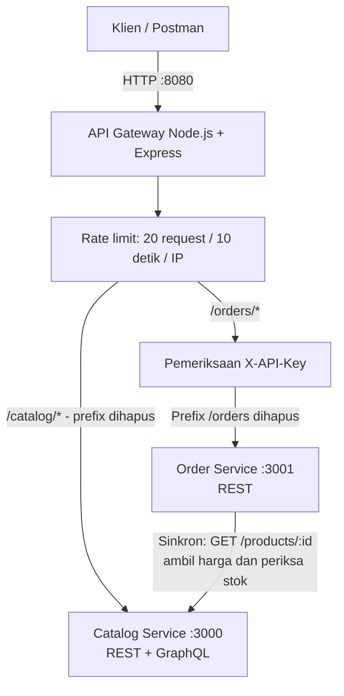
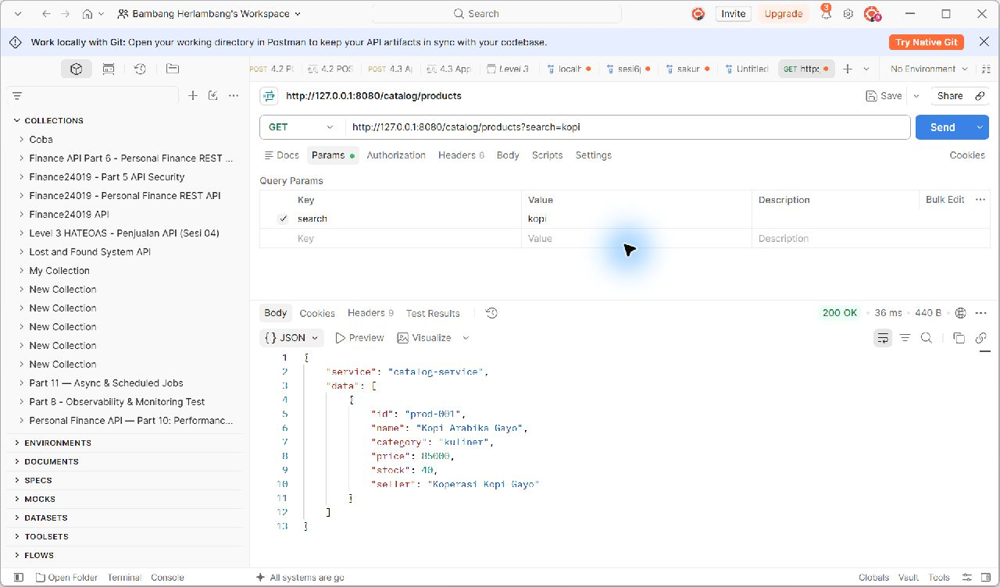
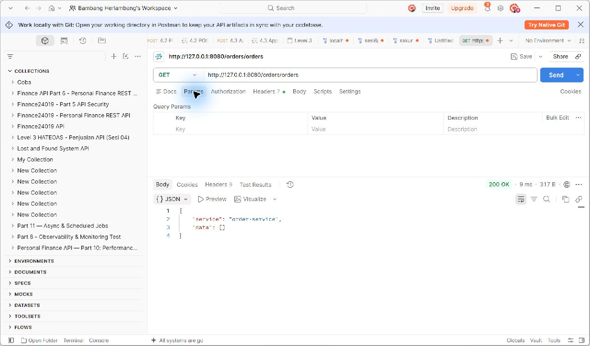
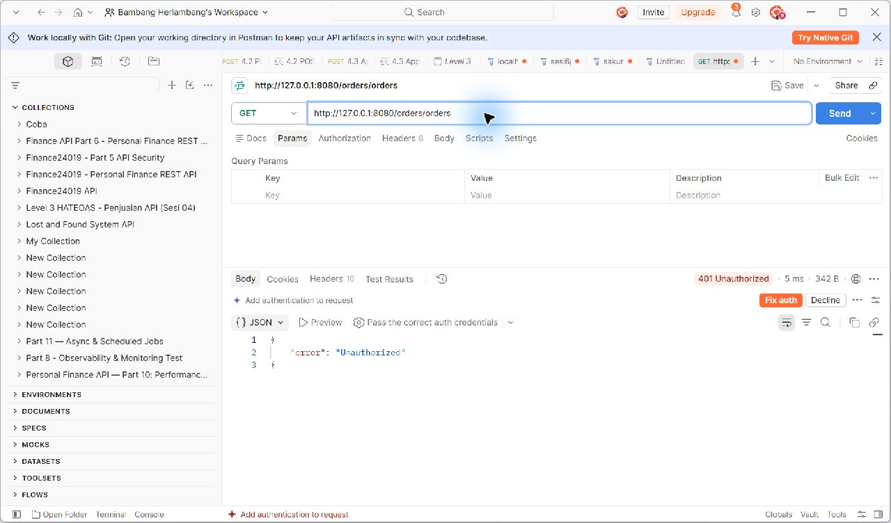
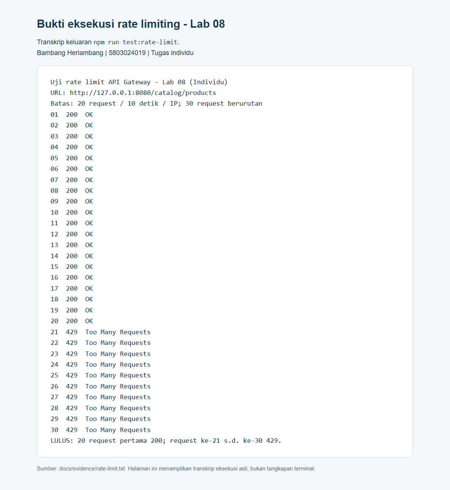

# Laporan Praktikum Web Service Sesi 08

**API Gateway Sederhana dengan Node.js dan Express**<br>
Nama: **Bambang Herlambang**<br>
NIM: **5803024019**<br>
Jenis pengerjaan: **Individu**<br>
Repository: [prakwebservice-lab08-api-gateway](https://github.com/academicbambang/prakwebservice-lab08-api-gateway)

## 1. Tujuan dan batas pengerjaan

Praktikum ini membuat satu pintu masuk untuk dua service demo, membuktikan routing berdasarkan path, dan membatasi request pada gateway. Implementasi menggunakan Node.js, Express, `http-proxy-middleware`, dan `express-rate-limit` sesuai Opsi A Lab 08. Tantangan API key juga diterapkan pada jalur pesanan.

Catalog Service dan Order Service digunakan sebagai konteks demo individu. Pekerjaan ini merupakan tugas praktikum gateway, bukan implementasi lengkap marketplace UAS. Materi Web Service sesi 8 dibaca sebagai acuan keamanan API key; materi Software Testing sesi 8 menjadi acuan pengujian batas dan skenario negatif. Tugas rancangan keamanan UAS serta tugas Java/JUnit tersendiri tidak termasuk hasil praktikum ini.

## 2. Arsitektur



[Diagram PNG](arsitektur.png) dan [diagram SVG](arsitektur.svg) tersedia untuk dilihat atau dilampirkan secara terpisah.

Klien memakai `http://127.0.0.1:8080` untuk kedua service. Gateway meneruskan request berdasarkan prefix, mempertahankan query string dan body, serta menghapus prefix sebelum menghubungi service. Katalog dapat diakses tanpa API key; jalur pesanan memerlukan key yang benar. Ketiga proses menyediakan `GET /health`.

| Request klien ke gateway | Tujuan service |
| --- | --- |
| `GET /catalog/products` | `GET http://127.0.0.1:3000/products` |
| `GET /catalog/products/:id` | `GET http://127.0.0.1:3000/products/:id` |
| `POST /catalog/graphql` | `POST http://127.0.0.1:3000/graphql` |
| `GET /orders/orders` | `GET http://127.0.0.1:3001/orders` |
| `GET /orders/orders/:id` | `GET http://127.0.0.1:3001/orders/:id` |
| `POST /orders/orders` | `POST http://127.0.0.1:3001/orders` |

URL `/orders/orders` disengaja: `/orders` pertama adalah namespace gateway untuk memilih service, sedangkan `/orders` kedua adalah resource milik Order Service. Ini mempertahankan pola prefix routing pada materi praktikum menggunakan nama domain katalog dan pesanan. Alias `/service-a` dan `/service-b` tidak digunakan.

## 3. Implementasi

Repository memakai npm workspaces untuk `gateway`, `catalog-service`, dan `order-service`. Setup membuat API key acak lokal dalam `gateway/.env`, sedangkan skrip start menjalankan ketiga proses secara lintas sistem operasi. Gateway juga dapat dijalankan langsung melalui `node gateway/gateway.js` dari root atau `node gateway.js` dari folder `gateway` setelah kedua service aktif. Pada stack, `PORT` mengatur port gateway, sedangkan `CATALOG_PORT` dan `ORDER_PORT` mengatur port masing-masing backend agar variabel `PORT` global tidak menyebabkan konflik.

Gateway membaca `PORT`, `HOST`, `CATALOG_SERVICE_URL`, `ORDER_SERVICE_URL`, `API_KEY`, dan `TRUST_PROXY` dari konfigurasi. Default lokal adalah host `127.0.0.1`, port `8080`, dan `TRUST_PROXY=0`. Untuk deployment opsional di platform seperti Render, `HOST=0.0.0.0` membuka listen pada antarmuka jaringan dan `TRUST_PROXY=1` digunakan bila terdapat satu reverse proxy terpercaya. Praktikum ini tidak mengklaim deployment publik telah dilakukan.

Rate limit dipasang sebelum routing sehingga setiap IP mendapat paling banyak 20 request selama 10 detik untuk seluruh endpoint gateway. Request berikutnya memperoleh `429 Too Many Requests`. Health check dan request yang ditolak juga menghabiskan kuota; pengujian batas harus dimulai dengan window yang bersih. Penyimpanan penghitung lokal berada dalam memori satu proses.

API key dikirim melalui header `X-API-Key`. Key server diubah menjadi hash dalam memori untuk pemeriksaan, dan konfigurasi `API_KEY_SHA256` dapat dipakai sebagai alternatif penyimpanan digest. Key tidak ditanam dalam kode atau file environment Postman yang di-commit. Header tidak ada atau tidak cocok menghasilkan `401 Unauthorized` pada jalur pesanan. Mekanisme ini merupakan pemeriksaan key demo; rotasi, pencabutan, dan izin per pengguna masih merupakan pengembangan berikutnya.

Parsing JSON dilakukan pada service tujuan agar body POST tidak habis dibaca sebelum melewati proxy. Catalog Service menyediakan REST untuk daftar/detail produk dan GraphQL untuk pemilihan field katalog. Order Service menyediakan daftar/detail pesanan dan pembuatan pesanan dengan `customerName` serta `items` berisi `productId` dan `quantity`. Header `Location` relatif dari upstream ditulis ulang dengan prefix gateway sehingga tautan detail pesanan tetap menuju pintu masuk yang sama.

Order Service mengambil detail produk dari katalog secara sinkron melalui `GET /products/:id` untuk menghitung harga pesanan. Data demo disimpan dalam memori dan hilang ketika proses dimulai ulang. Stok diperiksa, tetapi belum direservasi atau dikurangi; pesanan bersamaan belum dijamin konsistensinya oleh demo ini.

## 4. Prosedur dan skenario pengujian

### Menjalankan aplikasi dan Postman

```sh
npm install
npm run setup
npm start
```

Import collection dan environment dalam `docs/postman`. Pilih environment lokal dan isi `apiKey` dengan nilai lokal dari `gateway/.env`. Jalankan katalog terlebih dahulu untuk memperoleh ID produk yang digunakan pada pembuatan pesanan. Request katalog dan pesanan sama-sama harus menampilkan basis URL gateway dengan port `8080`.

Collection dijalankan manual melalui Postman ketika stack `npm start` aktif. Bila server hanya dikonfigurasi dengan `API_KEY_SHA256`, isi variabel Postman `apiKey` menggunakan key asli milik klien, bukan digest yang disimpan server. Pengujian alur otomatis menggunakan gateway dan service nyata termasuk dalam `npm test`.

### Pengujian otomatis

```sh
npm test
```

Pengujian memakai `node:test` dengan assertion otomatis. Unit test menguji logika yang dapat diisolasi, sedangkan integration test memeriksa perilaku HTTP gateway dan service; pengujian alur menyeluruh menggunakan gateway dan service nyata. Skenario negatif memastikan hasil penolakan, bukan sekadar memastikan request tidak menimbulkan exception. Batas penerimaan rate limit diperiksa pada request ke-20 dan ke-21.

| ID | Skenario | Hasil yang diharapkan |
| --- | --- | --- |
| GW-01 | Katalog melalui `/catalog/products` | `200`, data katalog dari Catalog Service |
| GW-02 | Pesanan melalui `/orders/orders` dengan key benar | `200`, data dari Order Service |
| GW-03 | Pesanan tanpa key atau key salah | `401`, request tidak diteruskan sebagai akses sah |
| GW-04 | Prefix routing dan query string | Prefix dihapus; query tetap diterima upstream |
| GW-05 | POST JSON ke GraphQL dan pesanan | Body utuh diterima service; respons tidak menggantung |
| GW-06 | Route gateway tidak terdaftar | `404` |
| GW-07 | Batas request dari satu IP pada window bersih | Request 1-20 `200`; request 21-30 `429` |
| GW-08 | Window berakhir | Request dapat diterima lagi setelah jendela limit habis |
| GW-09 | Input pesanan tidak valid | Ditolak sebagai kesalahan klien, tanpa membuat pesanan sah |
| GW-10 | Upstream tidak tersedia | Respons gateway terkendali, tanpa request menggantung |

### Bukti khusus rate limiting

Hentikan stack `npm start` terlebih dahulu agar port tidak digunakan, kemudian jalankan:

```sh
npm run test:rate-limit
```

Perintah menyiapkan stack baru lalu mengirim 30 request berurutan ke endpoint katalog yang valid. Target bukti adalah 20 status `200` diikuti 10 status `429`. Untuk menguji server yang sudah aktif, gunakan `node gateway/test-rate-limit.js` setelah menunggu setidaknya 10 detik tanpa request dari IP yang sama. Pisahkan demonstrasi ini dari request Postman agar kuota awal tidak terpakai.

## 5. Bukti pengumpulan dan status verifikasi

Eksekusi `npm test` telah lulus **35 dari 35 test**, tanpa kegagalan, sesuai [log pengujian aktual](evidence/tests.txt). Demonstrasi rate limiting menghasilkan 20 respons `200` diikuti 10 respons `429`. Screenshot Postman menunjukkan kedua service diakses melalui port gateway `8080`, dan akses pesanan tanpa key ditolak `401`.

| Pemeriksaan | Metode / endpoint | Hasil aktual | Bukti |
| --- | --- | --- | --- |
| Katalog melalui gateway | Postman: `GET /catalog/products?search=kopi` pada port `8080` | `200`, data produk sesuai pencarian | [Screenshot katalog](evidence/postman-catalog.png) |
| Pesanan melalui gateway | Postman: `GET /orders/orders` pada port `8080`, key benar | `200`, `service: order-service`, `data: []`; key disembunyikan | [Screenshot pesanan](evidence/postman-orders.png) |
| Penolakan akses tanpa key | Postman: request pesanan tanpa `X-API-Key` | `401 Unauthorized` | [Screenshot negatif](evidence/postman-unauthorized.png) |
| Batas request | Skrip 30 request berurutan pada window bersih | Request 1-20 `200`, request 21-30 `429`; lulus | [Log asli](evidence/rate-limit.txt), [JSON](evidence/rate-limit.json), [screenshot transkrip](evidence/rate-limit.png) |
| Unit, integrasi, dan alur menyeluruh | `npm test` menggunakan `node:test` | 35 test, 35 lulus, 0 gagal | [Log pengujian](evidence/tests.txt) |

Screenshot rate limiting merupakan tangkapan [halaman transkrip](evidence/rate-limit.html) yang bersumber dari log eksekusi asli `rate-limit.txt`, bukan tangkapan terminal langsung. Daftar pesanan pada screenshot kosong karena proses demo baru dijalankan; pembuatan pesanan dengan perhitungan harga katalog diuji dalam suite otomatis.

<details>
<summary>Lihat tangkapan layar bukti</summary>

**Katalog melalui gateway - 200**



**Pesanan melalui gateway - 200**



**Pesanan tanpa API key - 401**



**Rate limit - 20 respons 200, lalu 10 respons 429**



</details>

Diagram arsitektur tersedia pada bagian 2. Tautan repository di bagian identitas menyediakan `gateway.js`, `package.json`, konfigurasi contoh, dan skrip pengujian untuk reproduksi.

Audit dependensi menemukan `braces@3.0.3` melalui rantai `http-proxy-middleware@3.0.7 -> micromatch -> braces` yang terdampak [GHSA-vfj7-8cjw-p6xm](https://github.com/advisories/GHSA-vfj7-8cjw-p6xm); pada pemeriksaan 21 Oktober 2026 belum tersedia versi perbaikan. Inspeksi `node_modules/http-proxy-middleware/dist/path-filter.js` menunjukkan filter fungsi menuju pencocokan kustom, sedangkan pemrosesan glob menggunakan `micromatch`. Gateway memakai filter fungsi dengan prefix statis, tanpa pola glob dari input pengguna, sehingga jalur `braces` tersebut tidak dipakai oleh routing. Advisory tetap tercatat dan audit tidak diklaim bersih.

## 6. Refleksi

Klien cukup mengetahui satu alamat gateway untuk mengakses katalog dan pesanan. Perubahan alamat atau port service dapat dilakukan melalui konfigurasi gateway tanpa mengubah alamat yang dipakai klien. Penerapan rate limit dan pemeriksaan API key di pintu masuk membuat kebijakan akses lebih mudah dipantau secara konsisten. Jika gateway mati, kedua service tidak dapat diakses melalui alamat tersebut sehingga gateway menjadi titik kegagalan yang perlu ditangani pada pengembangan berikutnya.

## 7. Kaitan dengan materi dan kelanjutan

Penggunaan header API key, penyimpanan secret di environment, dan pembandingan hash mengikuti konsep keamanan sesi 8 Web Service. BVA diterapkan pada batas request 20 dan 21, sedangkan input negatif serta akses tanpa key diuji dengan assertion otomatis sesuai prinsip pengujian Software Testing. Tugas Java/JUnit minimal delapan test dan rancangan keamanan proyek UAS merupakan penugasan terpisah dari praktikum ini.

Pengujian pada repository merupakan verifikasi pengembang untuk tugas individu.

## 8. Referensi

1. Philipus Suryo Subandoro, **Praktikum Web Service Lab 08: API Gateway Sederhana**. Sumber lokal workspace: `materi/2prakwebservice/sesi8.txt`.
2. Philipus Suryo Subandoro, **Web Service Sesi 08: Keamanan Lanjutan dan Kick-off Proyek**. Sumber lokal workspace: `materi/1webservice/sesi8.txt`.
3. Philipus Suryo Subandoro, **Software Testing Sesi 08: Unit Testing (JUnit) dan Proyek Lintas Mata Kuliah**. Sumber lokal workspace: `materi/3softwaretesting/sesi8.txt`.
4. [Dokumentasi resmi http-proxy-middleware](https://github.com/chimurai/http-proxy-middleware), konfigurasi proxy dan penghapusan prefix dengan `pathRewrite`.
5. [Dokumentasi resmi express-rate-limit](https://express-rate-limit.mintlify.app/reference/configuration), konfigurasi window, batas request, dan respons `429`.

Ketiga materi lokal berada di folder `materi` pada workspace induk repository. Materi memberi dasar requirement praktikum dan pembatasan scope; dokumentasi resmi digunakan untuk implementasi middleware.
